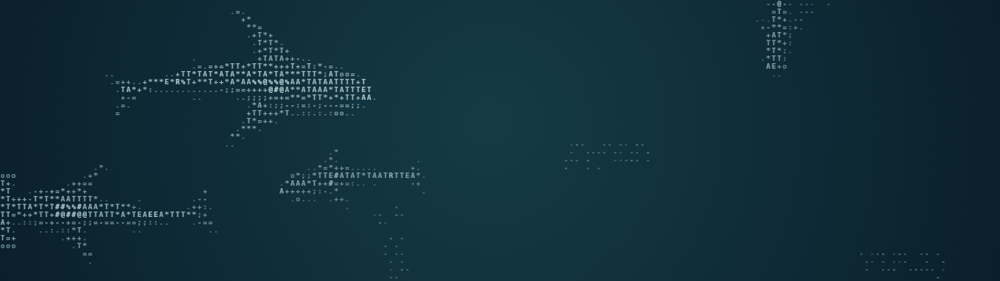

<h1 align="center">Ethan</h1>

AI 应用工程 · AI Agent · Vibe Coding

  

把想法落到具体项目里。这里放着我的 AI 应用实践、工具探索和中文资料整理。

## 项目实践

<table>
  <tr>
    <td width="50%" valign="top">
      

      <h3><a href="https://github.com/EthanAIDev/ChatBI-Stock">ChatBI-Stock</a></h3>
      
用自然语言查询股票数据，串联 SQL 生成、图表展示与 ARIMA 趋势分析。

      
Python · FastAPI · React · LangChain

    </td>
    <td width="50%" valign="top">
      

      <h3><a href="https://github.com/EthanAIDev/ViBlog">ViBlog</a></h3>
      
将三维交互、项目案例与技术笔记融为一体的个人技术网站。

      
Astro · React · TypeScript · Three.js

    </td>
  </tr>
</table>

## 开源协作

<table>
  <tr>
    <td width="50%" valign="top">
      

      <h3><a href="https://github.com/EthanAIDev/ai-coding-dictionary-zh">AI 编程词典</a></h3>
      
AI 编程词典的中文汉化，方便理解和查阅术语。

      
原作：<a href="https://github.com/mattpocock/dictionary-of-ai-coding">Matt Pocock / Dictionary of AI Coding</a>

    </td>
    <td width="50%" valign="top">
      

      <h3><a href="https://github.com/EthanAIDev/wechat-toast">wechat-toast</a></h3>
      
Windows 微信 4.x 桌面通知工具，支持本地浮层与系统通知。

      
Python · UI Automation 基于 fenqijun/wechat-notifier 改进

    </td>
  </tr>
</table>

[查看全部公开项目](https://github.com/EthanAIDev?tab=repositories)

字符海洋改编自 <a href="https://github.com/stackedlol/ascii-sharks">ascii-sharks</a> · <a href="./ATTRIBUTION.md">来源与许可</a>
